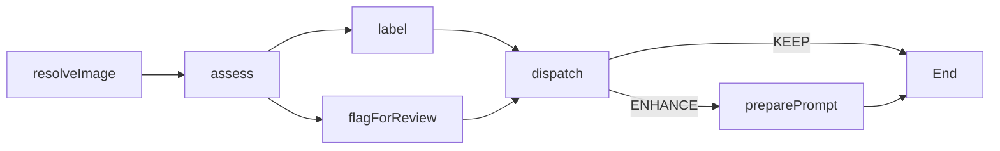

# Image prompting and hop logs

The prompter is a NestJS provider (`ImagePrompterService`) invoked by the LangGraph
`preparePrompt` node. It uses the original image and quality assessment to generate
structured editing instructions. No enhancer or image-generation call is implemented.



The existing low-confidence threshold is 0.6. Low-confidence runs retain
`needsReview: true`; they can generate a draft prompt but do not perform any edits.
The future enhancer must honor that flag. The router's downstream methods are still
placeholders; a returned destination does not mean an image has been enhanced or published.

## API

Existing authenticated endpoints now return `runId` and `enhancementPrompt` alongside
their existing assessment fields:

- `POST /agent/assess-image` with `{ "imageUrl": "https://..." }`
- `POST /agent/assess-image/file` with multipart field `file`
- `POST /upload/image` with multipart field `file` (stores in Uploadcare first)

The Uploadcare endpoint now delegates to the same image graph, including confidence
handling and prompting, after upload and storage complete.

For `KEEP`, `enhancementPrompt` is `null`. For `ENHANCE`, its shape is:

```json
{
  "prompt": "Conservatively lift the shadows while preserving the original dish.",
  "edits": [
    {
      "issue": "underexposure",
      "instruction": "Lift shadows on the food.",
      "priority": "high"
    }
  ],
  "preserve": ["Ingredients, portions, arrangement and serving vessel"],
  "negativePrompt": "No added ingredients, invented details, text or branding."
}
```

`GET /agent/assessments/:runId/events` returns the caller's events in timestamp order.
It requires the existing Clerk bearer token and filters by both user ID and run ID.
`GET /agent/assessments` also returns the persisted enhancement prompt. An assessment's
`id` is its `runId`. Failed runs remain discoverable in assessment history when
database persistence succeeds.

## Logging

Every executed image-graph node, pipeline boundary, Uploadcare upload/storage step,
and final assessment write emits `started` plus `completed` or `failed` events to
`pipeline_events`. A `hopId` pairs each start with its outcome; `runId` correlates
the complete request. Node latency, model/prompt version, structured outputs and
failure messages are recorded. Raw image bytes and base64 payloads are excluded
from these database event records. A skipped branch does not emit a fake execution.

Prompter provider retries are disabled so a failed prompter call is visible as a failed
hop; graph-level retry/evaluation loops are future work. Earlier quality evidence remains
in events if prompting fails. Logging is best-effort: database outages emit Nest errors
but preserve the operation's result or original error. Event persistence is not guaranteed
during a database outage.

## Enhancement QA and iteration metrics

`ImageQaModule` exports `ImageQaService.evaluate(input)`. It is registered in the
agent module, ready for a future enhancer node. The graph still ends at
`preparePrompt`: QA requires a real enhanced image and is not run on a prompt.
There is no new public endpoint, automatic retry loop, or publication step.

The QA input contract (`src/image-qa/image-qa.schema.ts`) is:

- `runId`, `userId`: the existing pipeline context.
- `original`: immutable source `{ buffer, mimeType }` for fidelity comparison.
- `enhanced`: future enhancer output `{ buffer, mimeType, iteration }`; iteration
  is a positive, one-based integer counting generated candidates.
- `enhancementPrompt`: the structured editing plan used for this candidate.
- `needsReview`: the upstream review hold; callers must carry it forward.

Both images must be nonempty JPEG, PNG, or WebP buffers within the existing 10 MB
limit. The Gemini judge sees the original first and candidate second, together
with the requested edits, preservation constraints, and negative prompt.
It returns 0–1 scores for improvement, edit adherence, preservation, and absence
of artifacts, plus confidence, observed violations, remaining issues, and reasoning.

Application policy v1 passes a candidate only when confidence is at least 0.6,
improvement at least 0.7, edit adherence at least 0.8, preservation and artifact-free
scores at least 0.9, visible improvement is reported, and there are no preservation
violations. An upstream hold or QA confidence below 0.6 sets `needsReview` and
prevents a pass. These initial thresholds require calibration against human labels.

Each evaluation emits `evaluate_enhancement` started/completed/failed events with
iteration, model, prompt version, policy thresholds, timing, and the completed
`metadata.qa` result. Existing authenticated run-event retrieval exposes this
history. Image bytes are excluded. Persistence retains the existing best-effort
behavior; no migration is needed and no durable retry state is claimed.

`summarizeQaIterations` accepts one run's consecutive results starting at iteration
1 and returns `confidenceAtK`, `passedAtK`, `passedByK`, and
`firstPassedIteration`. Confidence is the judge's certainty, not the probability
of improvement. Passing **by** k means at least one accepted candidate among the
first k iterations; a later failure does not erase an earlier pass. Across a fixed
evaluation cohort, the pass-by-k rate is the fraction of runs passing by k.
This helper does not calculate that cohort rate or the independent-sampling pass@k
estimator. Failed provider calls have no QA score and must not count as passes.
Retry orchestration, cohort aggregation, and human-label validation remain future work.

QA uses `IMAGE_QA_MODEL`, falling back to `GEMINI_MODEL` and then the quality
agent's default. Provider retries are disabled. Tests use fixture model responses;
live Gemini QA quality and calibration have not been verified.

## Configuration and verification

Uses `GEMINI_API_KEY`. `IMAGE_PROMPTER_MODEL` overrides the prompter model; otherwise
it uses `GEMINI_MODEL`, then the same default as the quality agent.

Apply the additive migration before running the updated server:

```sh
npm run db:migrate
npm test -- --runInBand
npm run build
```

Inspect a run directly in Postgres:

```sql
SELECT step, status, hop_id, latency_ms, metadata, error_message, created_at
FROM pipeline_events
WHERE run_id = '<runId>'
ORDER BY created_at, id;

SELECT id, status, enhancement_prompt
FROM image_assessments
WHERE id = '<runId>';
```

The migration adds a nullable `enhancement_prompt` column and a separate event table;
existing assessment rows remain valid. Event rows intentionally have no foreign key
to the assessment table because they are written before the final summary.
